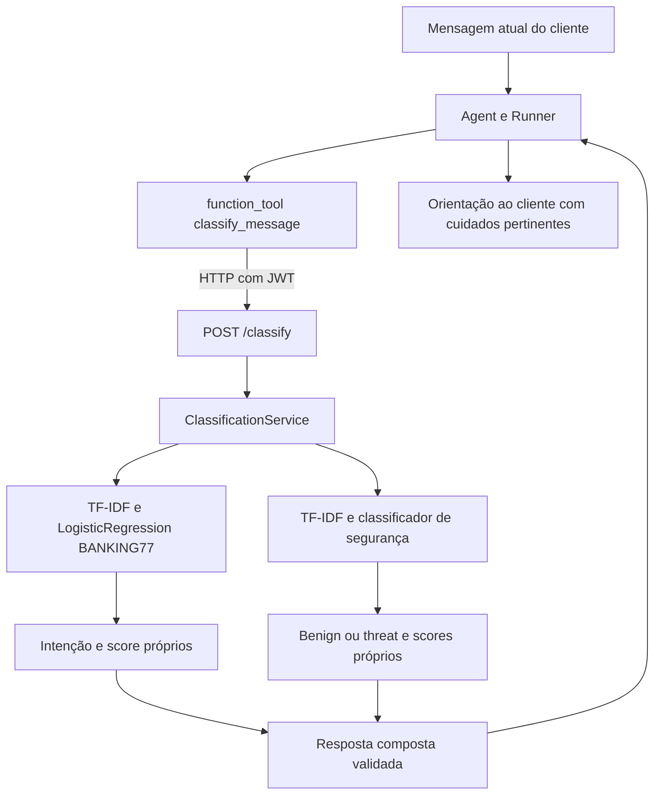

# Arquitetura de Dados e IA — intenções bancárias e segurança

Decisão registrada em 13/11/2026 para o TP4.

## Objetivo e continuidade

O Fintech Guard combina atendimento bancário com análise de conteúdo suspeito.
O BANKING77 responde **qual solicitação bancária o cliente faz**. O dataset de
segurança responde **se o conteúdo apresenta sinais associados a ameaça**.
São tarefas complementares, com rótulos, distribuições e avaliações próprios.

No TP2, o aprofundamento estatístico se concentrou em segurança. O TP3 planejou
o classificador benigno/ameaça, que foi implementado inicialmente no TP4. Este
adendo retoma o componente BANKING77 como classificador principal de intenções
exigido na rubrica e mantém o classificador de segurança ativo. Não altera os
notebooks, resultados ou documentos históricos dos TPs anteriores.

As bases não são concatenadas nem seus rótulos transformados numa única taxonomia.
Uma classe como `lost_or_stolen_card` pode coexistir com uma análise `benign` ou
`threat`; o segundo resultado não muda o significado da intenção bancária.

## Fluxo proposto



O serviço composto entrega os dois resultados sem fundir scores. O agente usa
a intenção para orientar o atendimento e a segurança para contextualizar os
cuidados. Um relato legítimo de golpe pode conter texto ameaçador. Não há
ferramentas de movimentação financeira, consulta de saldo ou bloqueio de cartão.
`POST /classify` e a autenticação HTTP são integração do Integrante B; o diagrama
descreve o fluxo de destino, não uma execução real já comprovada.

## Dados e experimentos separados

| Item | BANKING77 | Segurança |
| --- | --- | --- |
| Alvo | 77 intenções originais de atendimento | `benign` versus `threat` |
| Dados | Base processada no TP1, revalidada no TP4 | 603 mensagens tratadas e rastreáveis |
| Partição | 9985 no treino derivado; 3079 no teste TP1 preservado | 483 no treino; 120 no teste interno |
| Ajuste | TF-IDF e LogisticRegression, seleção por macro-F1 no treino | Pipeline e protocolo binário próprios |
| Artefato | `models/TP4/banking77/` | `models/TP4/security/` |
| Avaliação | Métricas por classe, matriz de confusão, ROC-AUC multiclasse e baseline | Métricas binárias, matriz de confusão, ROC-AUC e baseline |

Do treino BANKING77 original de 9993 linhas, foram excluídas oito linhas em
componentes de mensagens semelhantes que tocavam o teste. A regra é baseada no
texto e foi registrada antes da avaliação do modelo. As linhas de teste e os
dados históricos permanecem intactos; o treino derivado está em
`data/processed/TP4/banking77/train.csv`. A [auditoria](banking77/data_audit.json),
o [manifesto](banking77/split_manifest.csv) e as
[exclusões](banking77/excluded_training_rows.csv) registram a decisão.

O [protocolo BANKING77](banking77/protocol.json) fixa nove combinações:
`C` em 0.1, 1 e 10 e `ngram_range` em (1,1), (1,2) e (1,3). O GridSearchCV usa
cinco folds agrupados no treino; TF-IDF é ajustado dentro de cada fold. A seleção
não usa o teste. O modelo final é comparado com baseline majoritária e pipeline
inicial, sem pressupor ganho de desempenho.

As métricas executadas pertencem ao respectivo relatório e artefato; números do
classificador de segurança não servem como evidência do BANKING77. O teste
BANKING77 já foi explorado na EDA, portanto é benchmark interno da base, não
validação externa inédita. As heurísticas de similaridade reduzem vazamento,
mas não demonstram independência de autores, fontes ou templates desconhecidos.

## Organização e responsabilidades

```text
notebooks/TP4/
  banking77/01_classificacao_intencoes.ipynb
  security/01_classificacao.ipynb
models/TP4/
  banking77/{classifier.joblib,metadata.json}
  security/{classifier.joblib,metadata.json}
ml/
  banking77_labels.json
  banking_classifier.py
  security_classifier.py
  classification_service.py
fintech_agent/{runtime.py,demo.py}
reports/TP4/
  banking77/
  classification/
  arquitetura_dupla.md
  contrato_classify.md
  alinhamento_francisco.md
```

O Integrante A mantém preparação, treinamento, avaliação, artefatos, inferência
e agente. O Integrante B integra o serviço à API, schemas e JWT, valida a
inicialização/OpenAPI e executa os testes de API e o pentest adversarial.
A validação da conversa real e da consistência da entrega integrada é conjunta.

## Limitações e evidências ainda necessárias

- As bases são em inglês. Resultados em português, linguagem bancária real e
  mudanças de domínio precisam de validação independente.
- BANKING77 sempre escolhe uma de suas 77 classes. Não cobre todos os assuntos
  financeiros e não contém um detector validado de intenção desconhecida.
- As probabilidades não foram calibradas para decisões reais. Não há limiar
  validado de bloqueio automático, nem autorização financeira pela classificação.
- A base de segurança é pequena, com questões de representatividade e licença
  registradas em sua documentação. Resultado interno alto não resolve esses limites.
- A conversa real exige a API integrada, chave/modelo OpenAI e JWT de conta
  sintética. Testes offline não comprovam a qualidade das respostas de um LLM real.
- Os ataques, evidências e log parcial do pentest permanecem no escopo de B.

O [contrato composto](contrato_classify.md) define a integração. O
[documento de integração](alinhamento_francisco.md) apresenta as responsabilidades
do Integrante B, os critérios de conclusão e as evidências pendentes.
