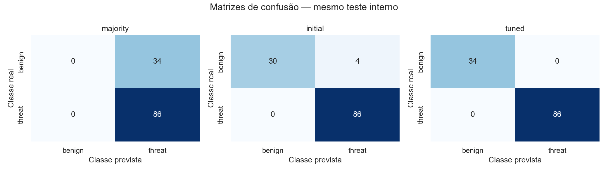
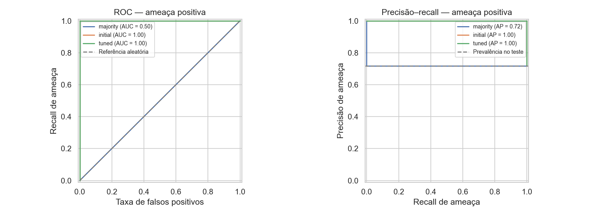
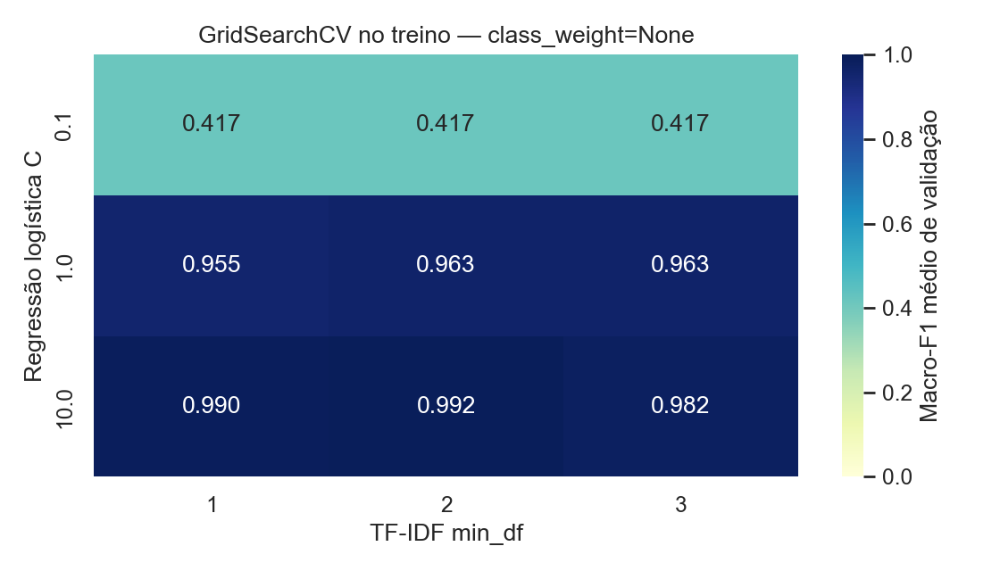

# TP4 — Relatório de classificação de conteúdo de segurança

Fintech Guard | Integrante A — Dados e IA | Experimento tp4-security-binary-v1

## 1. Pergunta e dados

Este é o componente ativo de segurança da arquitetura dupla do Fintech Guard.
Seu objetivo é classificar conteúdo textual como benigno (`benign`) ou ameaça (`threat`),
preservando o experimento planejado no TP3. O classificador principal de intenções
de atendimento é o [BANKING77](classificacao_banking77.md), avaliado separadamente em
77 classes. O [adendo de arquitetura](arquitetura_dupla.md) registra essa composição.
O alvo deste componente não é a intenção pessoal do remetente nem uma intenção bancária.
Um cliente legítimo pode relatar um golpe; uma previsão `threat` não autoriza acusá-lo.

São 603 mensagens em inglês, já tratadas no TP1/TP2: 171 benignas e 432 ameaças.
Categorias originais: NOT-Malicious General Class 171, Phishing 110, Scareware 100,
Baiting 80, Malware 77 e Pretexting 65. Preservamos todas as linhas e seus rótulos.
O SHA-256 da base é `b416c4362ef0447340770b7c73a57d5705ecc8bbeaf2efc1c2a0de632707d5c1`.
Origem e limitações de uso permanecem documentadas em [dataset_security](../../docs/dataset_security.md).
A licença ainda não esclarecida limita afirmações de uso/redistribuição em produção.

No TP2, Mann–Whitney p≈0,1912 não sustentou diferença de comprimento entre Phishing e
benignos no nível de significância adotado. Isso não prova equivalência entre grupos e
não cria uma regra de fraude. O TP4 explora informação lexical supervisionada com TF-IDF.

## 2. Protocolo e prevenção de vazamento

A auditoria reproduziu os 603 registros, sem textos vazios, duplicatas exatas normalizadas
ou conflitos de rótulo. O agrupamento de similares identificou 53 pares, compondo 552 grupos
(40 com mais de uma linha; maior grupo com 5). Nenhum grupo contém os dois alvos binários.

Critério fixado antes do treino: NFKC/casefold/espaços; substituição de números, emails e
URLs apenas para comparação; templates iguais ou Jaccard ≥0,85 de conjuntos de 5-gramas
de caracteres para textos com ≥80 caracteres. Componentes conexos ficam no mesmo bloco.
Essa heurística reduz sobreposição identificável; não prova independência de autores/origem.

Divisão persistida antes das métricas: 483 treino (137 benignos/346 ameaças), 120 teste
(34/86), primeiro split de StratifiedGroupKFold de 5 partes com seed 42, estratificado
pelas seis categorias. Dentro do treino: cinco folds binários por grupos, seed 43.
Nenhum grupo atravessa treino/teste ou folds de validação. TF-IDF aprende vocabulário e
IDF exclusivamente dentro de cada ajuste. Não entram como atributos IDs, hashes, grupos
ou categoria. A partição da regressão TP3 não é apresentada como teste intocado.

O teste foi avaliado após fixar grade, métrica e limiar. Reexecuções idênticas reproduzem
esse experimento; não constituem novas avaliações independentes. Não foi feita mudança
de modelo, features ou limiar a partir de erros do teste.

## 3. Pipeline, baseline e GridSearchCV

Pipeline: TF-IDF de palavras, unigramas/bigramas, lowercase, sublinear_tf=True,
max_features=20000, sem remoção de stopwords; LogisticRegression com L2, solver liblinear,
max_iter=2000 e seed 42. Configuração inicial C=1, min_df=1, sem pesos.

Baseline `DummyClassifier(strategy="prior")`: prevê sempre a maioria e retorna proporções
constantes do treino. Grade: C=[0.1,1,10], min_df=[1,2,3], class_weight=[None,balanced].
São 18 candidatos e 90 ajustes de CV, mais o refit selecionado no treino completo.
Os dois primeiros parâmetros têm os três valores mínimos exigidos pelo enunciado.

Melhores parâmetros: **C=10,
min_df=2, class_weight=None**.
Seleção por maior macro-F1 médio, sem uso do teste. A média do vencedor pode ser otimista
por ter sido selecionada entre candidatos; seu desvio padrão não é intervalo de confiança.
Limiar fixo: threat quando P(threat)>0,5; empate retorna benigno, como no predict do modelo.

## 4. Resultados e aprendizado útil

| Modelo | Macro-F1 CV (média ± DP) | Macro-F1 teste | ROC-AUC teste | Average Precision teste |
| --- | --- | --- | --- | --- |
| majority | 0.4174 ± 0.0014 | 0.4175 | 0.5000 | 0.7167 |
| initial | 0.9551 ± 0.0289 | 0.9574 | 1.0000 | 1.0000 |
| tuned | 0.9925 ± 0.0061 | 1.0000 | 1.0000 | 1.0000 |

Ganho sobre a configuração inicial: **+0.0374 de macro-F1 na CV** e **+0.0426
no teste**. Ganho sobre a baseline no teste: **+0.5825**. O modelo aprendeu
associações úteis para separar os rótulos **neste dataset**, além da frequência da classe.
Isso não demonstra entendimento semântico robusto nem utilidade comprovada em produção.

A baseline tem acurácia 71,67%, mas recall benigno zero; por isso acurácia isolada é
enganosa. O modelo inicial comete quatro falsos positivos; o escolhido não comete erros
neste teste. ROC-AUC do inicial já é 1,0: ordenação correta não implica classificação
perfeita no limiar 0,5. A mudança de configuração alterou também os scores no limiar fixo.

| Classe do modelo escolhido | Precisão | Recall | F1 | Suporte no teste |
| --- | --- | --- | --- | --- |
| benign | 1.0000 | 1.0000 | 1.0000 | 34 |
| threat | 1.0000 | 1.0000 | 1.0000 | 86 |

Matriz, linhas reais/colunas previstas, ordem benign/threat:
`[[34, 0], [0, 86]]`. São **0 falsos positivos e 0 falsos negativos**.
Não observar erros em 120 exemplos não significa erro populacional zero.
Precisão/recall por categoria original também têm suporte reduzido; a avaliação continua
binária e não demonstra separação entre Phishing e Pretexting.

ROC-AUC utiliza scores contínuos P(threat), identificados por classes_, e resume ordenação
em vários limiares. Average Precision resume precisão–recall por degraus; não é área
trapezoidal. A prevalência de ameaça no teste é 86/120=71,67%. Os scores não foram
calibrados nem validados como probabilidades de fraude real.

A referência majoritária erra todos os 34 benignos; o inicial erra quatro; o selecionado
separa os 120 exemplos desta partição. A comparação usa exatamente os mesmos IDs de teste.

As curvas mostram a separação elevada no domínio interno. Sem conjunto externo, elas
não sustentam estimativas de desempenho em português ou num banco real.

O mapa mostra C×min_df para o peso escolhido. Todos os candidatos, incluindo balanced,
estão em [cv_results.csv](classification/cv_results.csv); o teste não escolhe a célula.

## 5. Verificação do resultado alto e limitações

A revisão conferiu os hashes e o alinhamento entre os 120 IDs de teste e as previsões.
Recalculou o IDF dos 2.827 termos do artefato usando somente os 483 textos de treino:
ele coincide com log((1+483)/(1+df_treino))+1, e todos os termos respeitam min_df=2.
Não foram encontrados prefixos residuais label/category/class nos textos de treino.

Como diagnóstico posterior ao treino, sem retreinar, foram observados possíveis atalhos
lexicais: as substrings download, attachment, click e password aparecem em 144, 131, 58
e 50 ameaças de treino, respectivamente, e em nenhum dos 137 benignos. Isso é compatível
com separação por estilo/coleta e não prova que o dataset é sintético. Não foram abertas
amostras textuais do teste para orientar ajustes. O [diagnóstico](classification/lexical_audit.json)
é descritivo, posterior ao experimento, e não integra a seleção do modelo.

Limitações: amostra pequena, base já explorada por EDA, possíveis templates não detectados,
ausência de metadados de autores, rótulos com sobreposição semântica, corpus em inglês,
limites de licença e ausência de avaliação externa. TF-IDF pode errar paráfrases, relatos
legítimos de golpes, negação e mensagens fora de vocabulário. Resultado perfeito interno
deve motivar validação externa mais rigorosa, não implantação automática.

## 6. Artefato, agente e próximos passos

O [pipeline joblib](../../models/TP4/security/classifier.joblib) foi ajustado somente no treino,
com [metadados](../../models/TP4/security/metadata.json) e dependências fixadas. O wrapper
recarregou e reproduziu os scores das 120 mensagens. Integridade por hash não substitui
confiança na origem de um objeto serializado.

O [serviço composto](../../ml/classification_service.py) carrega este modelo e o
classificador BANKING77. O [contrato público](contrato_classify.md) proposto usa
`task=banking_intent_with_security`, com `intent`, `probability` e `model_version`
do modelo bancário no nível principal. O campo `security` contém separadamente
`task=security_binary`, `label`, `probability`, `probabilities` e `model_version`
deste componente. Os scores não são somados nem representam uma confiança conjunta.
O limite é de 4000 caracteres, sem truncamento silencioso. B ainda deve integrar
o carregamento dos dois modelos na inicialização, implementar `/classify` com JWT
e validar o OpenAPI/HTTP. A API atual não foi alterada.

O [agente](agente.md) tem Agent, Runner e function_tool que chama HTTP com JWT privado,
memória e roteiro de três turnos. A intenção bancária orienta o atendimento, enquanto
o resultado de segurança orienta os cuidados, inclusive com relatos legítimos de golpes.
Os testes offline não demonstram resposta real de LLM. A evidência real depende de
chave/modelo OpenAI e da rota integrada; continua pendente.

Próximos passos de dados: coletar amostra externa bancária em português com direitos de uso
claros e anotações independentes; incluir relatos legítimos de golpes; avaliar custo dos erros,
calibração e revisão humana. SVM/char-ngrams do plano TP3 são comparadores futuros, não
experimentos executados aqui. Nova seleção exige validação adequada sem reutilizar este teste.

## Reprodução e referências

Ver [índice TP4](README.md), [protocolo](classification/protocol.json),
[manifesto](classification/split_manifest.csv), [previsões](classification/predictions.csv)
e [validação da composição](validation_dual/README.md). Para atualizar este texto a partir das métricas:
`python scripts/report_tp4.py`. Não treina nem modifica o artefato.

- [Planejamento TP3](../TP3/planejamento_T2.md).
- [Pipeline e vazamento](https://scikit-learn.org/stable/common_pitfalls.html).
- [GridSearchCV](https://scikit-learn.org/stable/modules/generated/sklearn.model_selection.GridSearchCV.html).
- [StratifiedGroupKFold](https://scikit-learn.org/stable/modules/generated/sklearn.model_selection.StratifiedGroupKFold.html).
