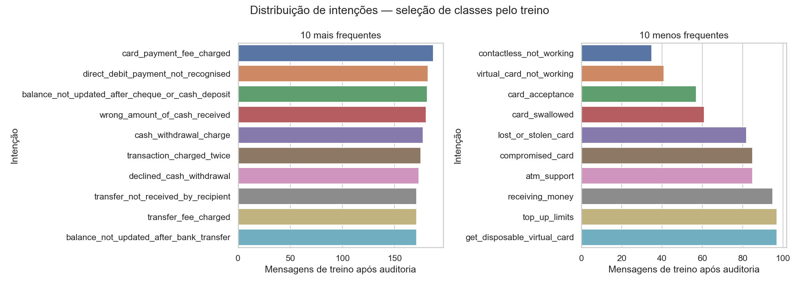
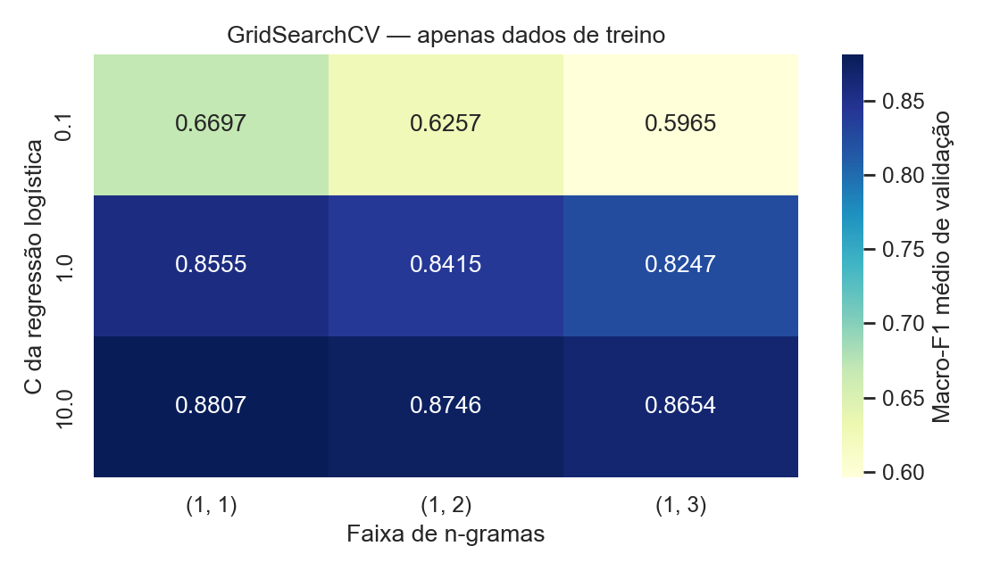
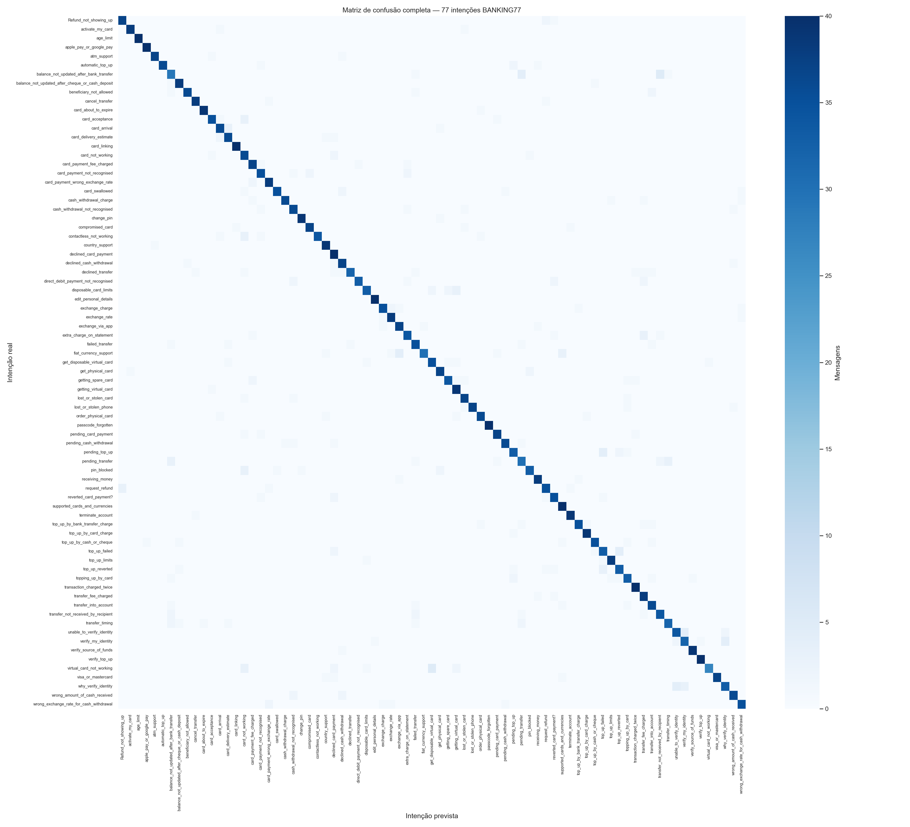
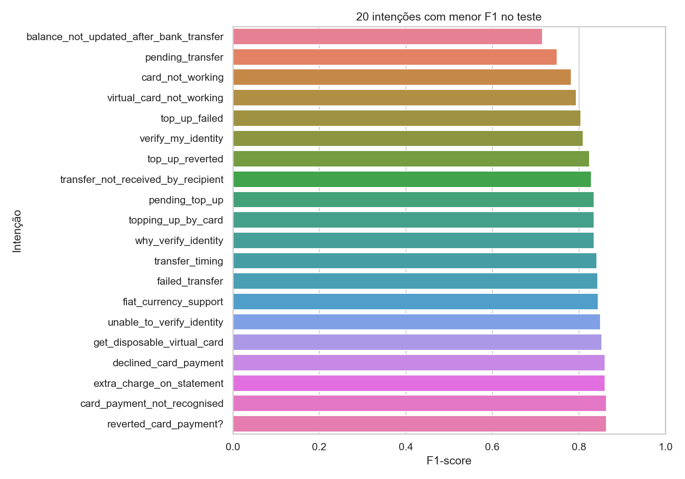
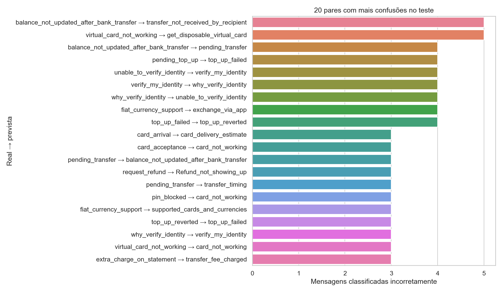
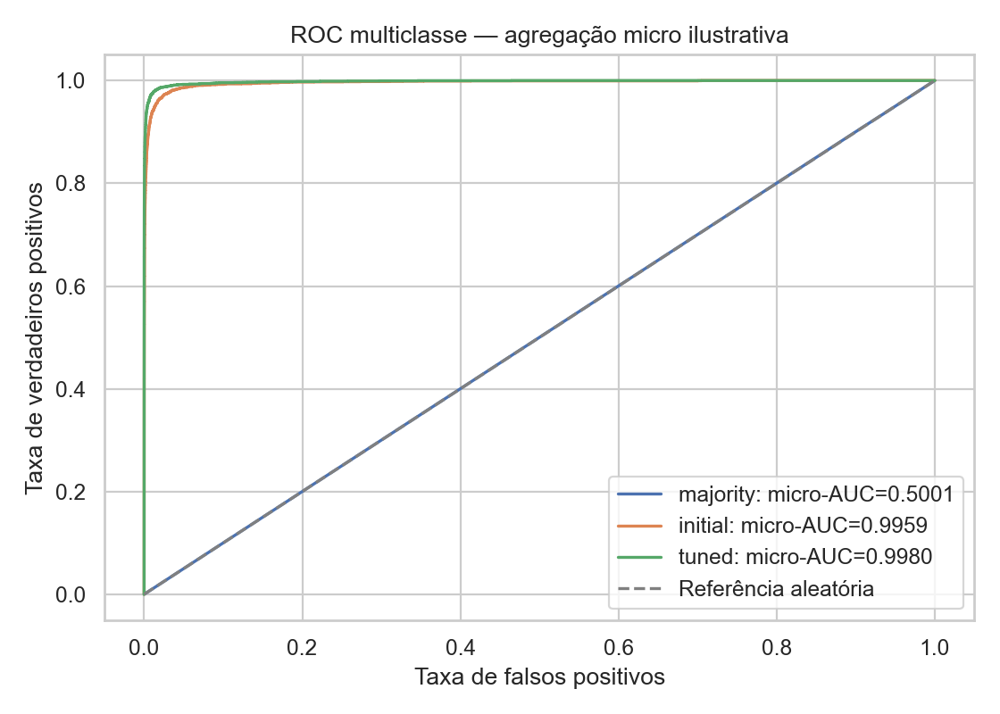

# TP4 — Classificação das 77 intenções bancárias

Fintech Guard | Integrante A — Dados e IA | Experimento `tp4-banking77-v1`

## 1. Problema, dados e arquitetura

Pergunta: dado o texto de atendimento, qual das **77 solicitações bancárias** ele expressa?
Esse é o classificador principal de intenções do TP4. O [classificador de segurança](classificacao.md)
continua ativo para analisar conteúdo benigno/ameaça; seus rótulos não são intenções bancárias.
Os dois modelos recebem o mesmo texto e devolvem resultados separados, conforme o
[adendo de arquitetura](arquitetura_dupla.md) e o [contrato de integração](contrato_classify.md).
Relatar um golpe não torna o cliente malicioso.

BANKING77 foi disponibilizado pela PolyAI com mensagens em inglês, 77 categorias,
10.003 registros de treino e 3.080 de teste na fonte original. A limpeza histórica do TP1
produziu 9.993/3.079. Os CSVs históricos foram preservados; no TP4, oito linhas do treino
em componentes de similaridade que tocavam o teste foram excluídas do **treino derivado**.
Resultado: **9.985 treino e 3.079 teste**, com as 77 classes presentes em ambos.
Fonte, licença CC BY 4.0 e citação permanecem em [dataset_banking77](../../docs/dataset_banking77.md).

As classes têm entre 35 e 187 exemplos no treino
retido e entre 39 e 40 no teste.
Os rótulos originais, incluindo `Refund_not_showing_up` e `reverted_card_payment?`,
foram preservados. A [distribuição completa](banking77/class_distribution.csv) registra
os 77 rótulos e exclusões; não há renomeação ou concatenação com rótulos de ameaça.

O gráfico apresenta as dez classes mais e menos frequentes no treino. A distribuição
é relativamente equilibrada; prever uma única classe cobre aproximadamente 1/77 do teste.

## 2. Protocolo e prevenção de vazamento

O [protocolo](banking77/protocol.json) e o [manifesto](banking77/split_manifest.csv)
foram persistidos antes da avaliação. Cada linha tem ID da fonte, hash do texto, rótulo,
grupo, destino e fold. A [auditoria](banking77/data_audit.json) e as
[oito exclusões](banking77/excluded_training_rows.csv) tornam a preparação rastreável.

Agrupamento sem consultar rótulos: normalização NFKC/casefold/espaços e substituição de
URLs, e-mails e números **somente para comparação**; templates iguais em qualquer tamanho
ou Jaccard ≥0,90 de conjuntos de 5-gramas de caracteres para textos com pelo menos
40 caracteres. Componentes conexos permanecem juntos. O algoritmo de prefixos gera
candidatos, mas a decisão usa a similaridade exata dos conjuntos completos.
Foram identificados 25 pares e 22 componentes com mais de uma linha, sem conflitos de
rótulo. Um componente tem duas linhas no teste preservado. A heurística reduz sobreposição
detectável, mas não prova independência por autor ou ausência de paráfrases.

Removemos do treino todos os componentes que tocavam o teste. As 3.079 linhas de teste,
seus textos e rótulos permaneceram intactos. Não foram usadas previsões para excluir dados.
No treino retido, StratifiedGroupKFold, cinco folds e seed 42, mantém cada grupo em um
único fold; as 77 classes aparecem em todas as partes de ajuste e validação.
TF-IDF aprende vocabulário e IDF **dentro do pipeline de cada fold**. IDs, grupos e hashes
não entram no modelo. O artefato final usa exclusivamente as 9.985 linhas do treino.

O teste já apareceu na EDA: é um benchmark interno do mesmo domínio, não uma amostra
externa inédita. Não houve alteração de grade, features ou limiar em resposta aos seus
erros. Reexecuções idênticas reproduzem este experimento, sem criar nova avaliação independente.

## 3. Pipeline, baseline e otimização

Pipeline scikit-learn: TfidfVectorizer → LogisticRegression multiclasse.
TF-IDF: lowercase, sublinear_tf=True, min_df=2, max_features=30000, sem remoção de stopwords.
Estimador: solver lbfgs, regularização L2, max_iter=1000, random_state=42.
Configuração inicial: C=1 e unigramas/bigramas. Não houve aviso de falha de convergência.

Baseline `DummyClassifier(strategy="prior")`: prevê sempre a classe mais frequente e
retorna a distribuição de classes do treino como scores constantes. A mesma partição
e os mesmos cinco folds permitem comparar baseline, inicial e modelo selecionado.

GridSearchCV testa **C=[0.1,1,10]** e **ngram_range=[(1,1),(1,2),(1,3)]**:
dois parâmetros com três valores cada, nove candidatos, 45 ajustes e refit do vencedor.
A métrica de seleção é macro-F1 médio dos folds, dando o mesmo peso a cada intenção.
Melhor configuração: **C=10,
ngram_range=(1, 1)**.
Não se usa o teste para escolher parâmetros, limiares ou modelos.

A grade mostra que adicionar n-gramas não garante melhora neste protocolo.
Os [resultados dos nove candidatos](banking77/cv_results.csv) documentam a comparação.
A média do vencedor é selecionada entre candidatos e pode ser otimista;
o desvio padrão dos folds não é intervalo de confiança.

## 4. Avaliação, métricas por classe e erros

| Modelo | Macro-F1 CV (média ± DP) | Acurácia teste | Macro-F1 teste | F1 ponderado teste | ROC-AUC OvR macro |
| --- | --- | --- | --- | --- | --- |
| majority | 0.0005 ± 0.0000 | 0.0130 | 0.0003 | 0.0003 | 0.5000 |
| initial | 0.8415 ± 0.0057 | 0.8600 | 0.8592 | 0.8592 | 0.9964 |
| tuned | 0.8807 ± 0.0049 | 0.9000 | 0.9001 | 0.9001 | 0.9980 |

O ganho sobre a configuração inicial foi **+0.0391 de macro-F1 na CV** e
**+0.0409 no teste** (cerca de 4.09 pontos percentuais).
Sobre a baseline, o ganho no teste foi **+0.8998**.
Há aprendizado útil das associações lexicais neste corpus: o resultado supera amplamente
a previsão de uma única classe. Isso não comprova compreensão robusta, adequação ao
português ou desempenho em atendimento bancário real.

O selecionado acertou **2771 de 3079** mensagens e errou **308**.
A matriz completa tem 77 linhas reais e 77 colunas previstas, na ordem validada de `classes_`.
As probabilidades completas foram guardadas para recalcular ROC-AUC, e a serialização
é verificada contra todas as previsões e scores do teste.

Predomínio da diagonal indica acertos, mas há trocas entre serviços próximos. Consulte
a [matriz CSV](banking77/confusion_tuned.csv) para os valores individuais e as
[métricas das 77 classes](banking77/per_class_tuned.csv), também impressas no notebook.
As dez classes com menor F1 são:

| Intenção | Precisão | Recall | F1 | Exemplos no teste |
| --- | --- | --- | --- | --- |
| `balance_not_updated_after_bank_transfer` | 0.7073 | 0.7250 | 0.7160 | 40 |
| `pending_transfer` | 0.7500 | 0.7500 | 0.7500 | 40 |
| `card_not_working` | 0.6923 | 0.9000 | 0.7826 | 40 |
| `virtual_card_not_working` | 0.9643 | 0.6750 | 0.7941 | 40 |
| `top_up_failed` | 0.7857 | 0.8250 | 0.8049 | 40 |
| `verify_my_identity` | 0.8205 | 0.8000 | 0.8101 | 40 |
| `top_up_reverted` | 0.8250 | 0.8250 | 0.8250 | 40 |
| `transfer_not_received_by_recipient` | 0.8095 | 0.8500 | 0.8293 | 40 |
| `pending_top_up` | 0.8462 | 0.8250 | 0.8354 | 40 |
| `topping_up_by_card` | 0.8462 | 0.8250 | 0.8354 | 40 |

O desempenho agregado não substitui a avaliação por intenção. Cada classe tem cerca
de 40 exemplos no teste, de modo que poucos erros alteram bastante seu recall/F1.
Não se apresenta ranking de classes como diferença estatisticamente estabelecida.

| Intenção real | Intenção prevista | Trocas observadas |
| --- | --- | --- |
| `balance_not_updated_after_bank_transfer` | `transfer_not_received_by_recipient` | 5 |
| `virtual_card_not_working` | `get_disposable_virtual_card` | 5 |
| `balance_not_updated_after_bank_transfer` | `pending_transfer` | 4 |
| `pending_top_up` | `top_up_failed` | 4 |
| `unable_to_verify_identity` | `verify_my_identity` | 4 |
| `verify_my_identity` | `why_verify_identity` | 4 |
| `why_verify_identity` | `unable_to_verify_identity` | 4 |
| `fiat_currency_support` | `exchange_via_app` | 4 |
| `top_up_failed` | `top_up_reverted` | 4 |
| `card_arrival` | `card_delivery_estimate` | 3 |

Há, por exemplo, trocas entre saldo não atualizado após transferência e transferência
não recebida, e entre cartão virtual indisponível e obtenção de cartão descartável.
Proximidade semântica é uma hipótese para futura revisão; a contagem não comprova sua causa.
Esse diagnóstico posterior à avaliação não foi usado para reajustar o modelo neste teste.

ROC-AUC usa scores contínuos e estratégia **One-vs-Rest**: cada classe contra as outras 76.
A média macro é 0.998020; a média ponderada é
0.998019. AUC alta mede ordenação dos scores,
**não** a proporção de classificações corretas nem calibração das probabilidades.
Muitos negativos fáceis em cada comparação podem coexistir com confusões entre intenções
semelhantes. Por isso macro-F1 e a matriz são centrais, além de ROC-AUC.

A curva acima agrega as decisões classe versus demais de forma **micro**, apenas como
visualização complementar. Não é uma curva macro. As médias macro/ponderada e AUC por
classe são calculadas separadamente nas tabelas. A baseline tem ROC-AUC OvR 0,5.

## 5. Artefatos, agente e integração

O [modelo serializado](../../models/TP4/banking77/classifier.joblib) contém TF-IDF e estimador.
Os [metadados](../../models/TP4/banking77/metadata.json) registram classes, versões,
hashes e treinamento sem o teste. O [wrapper](../../ml/banking_classifier.py) verifica
integridade e compatibilidade antes de carregar e rejeita entradas inválidas ou acima de
4000 caracteres. Hash de integridade não substitui confiança na origem de um joblib.

`ClassificationService` carrega BANKING77 e segurança uma vez e devolve os dois resultados.
A probabilidade da intenção fica no nível principal; segurança fica em `security` com
scores e versão próprios. Não há soma das probabilidades dos dois modelos.
O [agente](agente.md) utiliza intenção para orientar atendimento e segurança para cuidados,
sem realizar operações financeiras nem presumir que um relato de golpe é intenção maliciosa.

**Pendências:** B integra `/classify` com JWT, startup e contratos OpenAPI; a dupla configura
chave/modelo OpenAI e registra uma conversa real de três turnos. Testes offline não
substituem essa evidência. O [alinhamento com Francisco](alinhamento_francisco.md) detalha
as ações.

## 6. Limitações e próximos passos

- Ambas as bases estão em inglês. Tradução automática não constitui validação em português.
- BANKING77 é de conjunto fechado: o classificador sempre escolhe uma das 77 intenções.
  Não foi validada rejeição de assuntos desconhecidos, aconselhamento de investimentos
  ou conteúdo que não corresponda a uma solicitação bancária.
- Scores não calibrados; argmax não é um limiar validado de segurança ou autorização.
- A coleta e a EDA prévias limitam generalização. Agrupamento heurístico não resolve
  toda dependência entre textos; falta teste externo com direitos de uso e rótulos revisados.
- O componente de segurança mantém suas limitações próprias, incluindo corpus pequeno,
  licença não esclarecida e possível confusão entre relato legítimo e ameaça.

Próximos passos: integrar e testar o contrato real; executar a demonstração; coletar
avaliação externa em português e próxima do uso pretendido; estudar calibração, tratamento
de assuntos desconhecidos e revisão humana com validação própria. Novos experimentos
devem preservar uma avaliação independente, sem otimizar repetidamente neste teste.

## Reprodução e fontes

O [notebook executado](../../notebooks/TP4/banking77/01_classificacao_intencoes.ipynb)
reúne preparação, seleção, avaliação, seis figuras e carregamento do artefato.
Ver [instruções](README.md), [validação atual](validation_dual/README.md) e
[conferência das rubricas](rubricas_TP4.md).
Para regenerar apenas este relatório: `python scripts/report_tp4_banking.py`.

- [BANKING77 — fonte original e licença](https://github.com/PolyAI-LDN/task-specific-datasets#banking).
- [GridSearchCV](https://scikit-learn.org/stable/modules/generated/sklearn.model_selection.GridSearchCV.html).
- [ROC-AUC multiclasse](https://scikit-learn.org/stable/modules/generated/sklearn.metrics.roc_auc_score.html).
- [Boas práticas contra vazamento](https://scikit-learn.org/stable/common_pitfalls.html).
